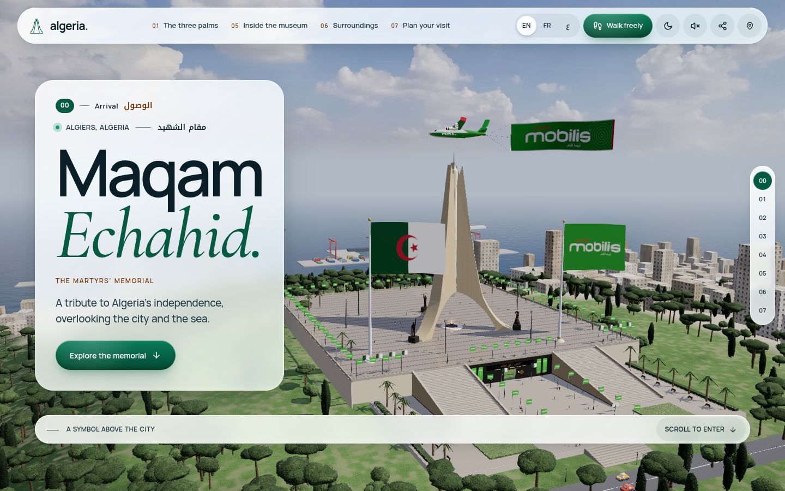
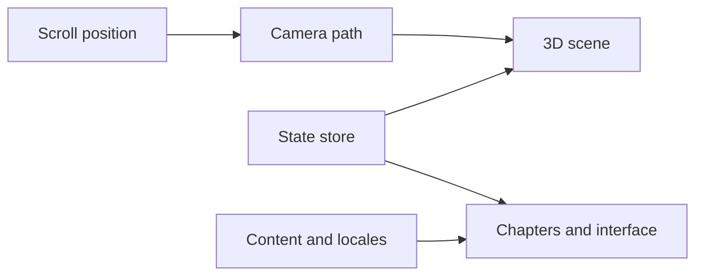
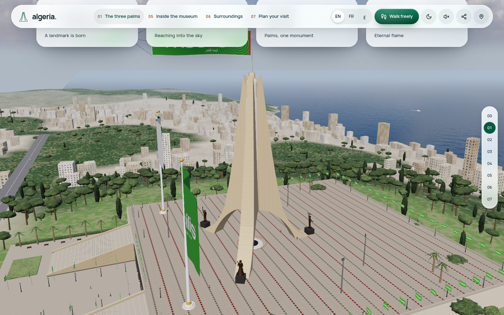
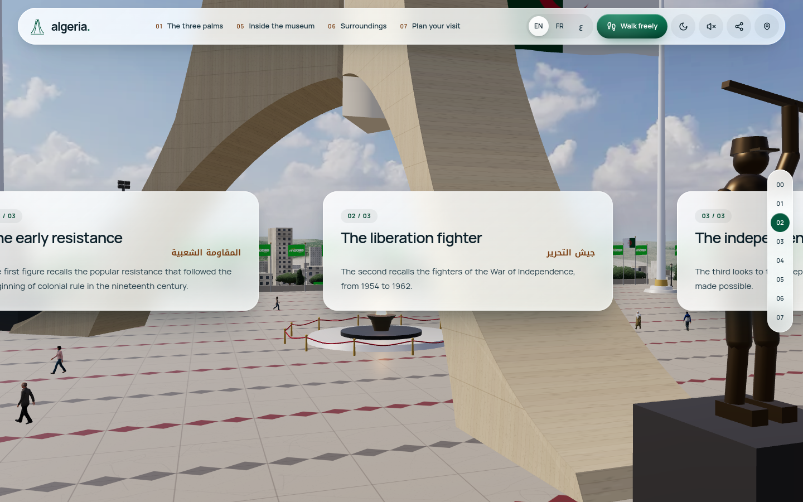
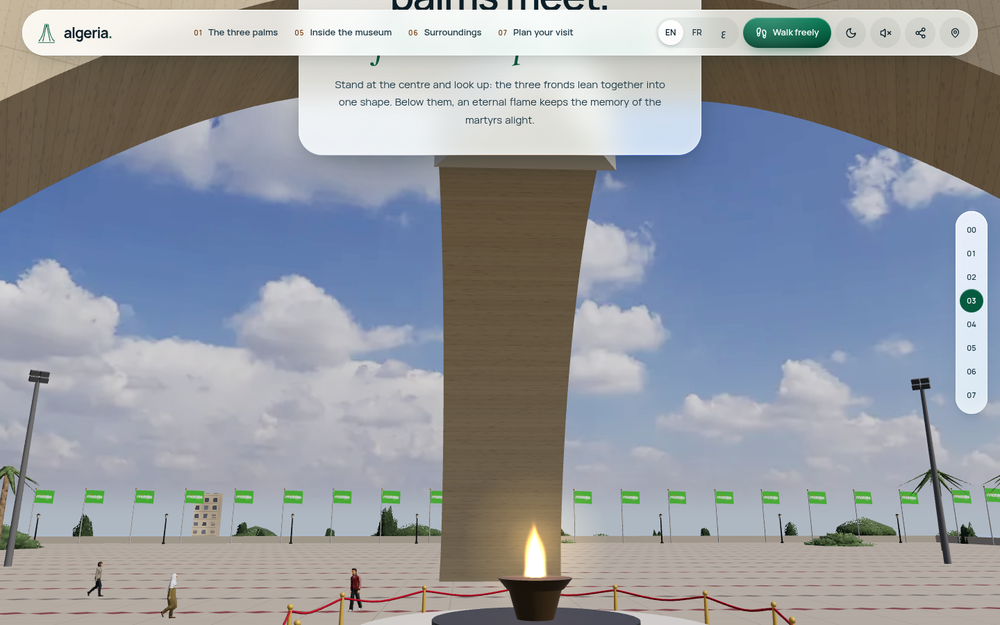
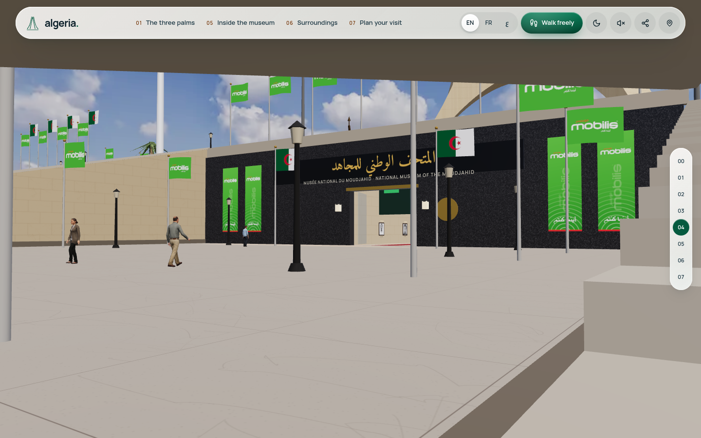
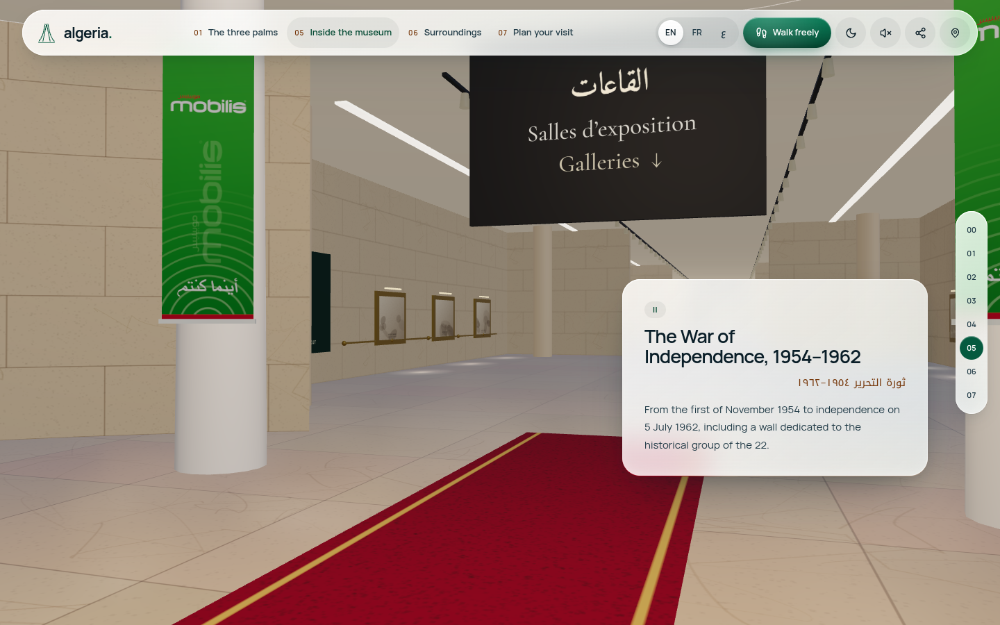
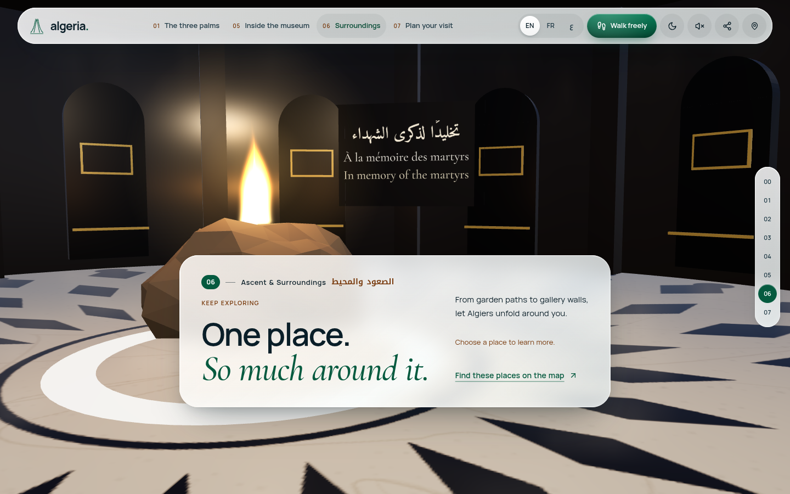
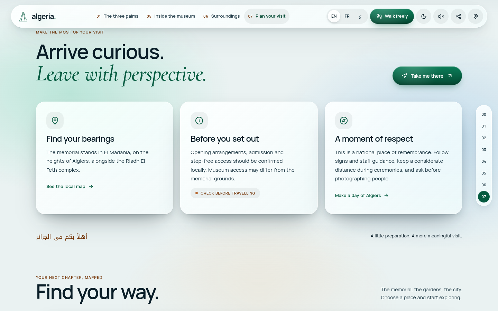

# Maqam Echahid 3D

Scroll-driven 3D guide to the Maqam Echahid memorial in Algiers.

A cinematic visit in the browser: the camera follows the scroll from the esplanade to the three palms, the guardians, the museum and the flame, with day and night, sound, a free walk mode and three languages.

> **Structure only.** The source code is private. Source files here are intentionally empty so you can see how the project is organized. Commands describe the private codebase.



## Features

- Eight scroll chapters on a spline camera path
- Day and night modes with an opening show
- Museum interior and free walk mode
- Animated visitors
- English, French and Arabic with shaped Arabic text in 3D
- Map of surroundings with a fallback when no token is set

## Architecture



## Engineering highlights

- Procedural architecture, terrain and textures
- Reduced motion and accessible controls
- Draco compression and lazy loading
- Documented sources and licenses

## Screenshots

| Arrival | Aerial view |
| --- | --- |
|  |  |
| **Guardians** | **Three palms** |
|  |  |
| **Museum entrance** | **Museum** |
|  |  |
| **Flame** | **Plan your visit** |
|  |  |

Captured from the running application with software rendering, so materials and effects look better on a real GPU.

## Main dependencies

`@fontsource/amiri`, `@fontsource/cormorant-garamond`, `@fontsource/manrope`, `@fontsource/noto-kufi-arabic`, `@react-three/drei`, `@react-three/fiber`, `@react-three/postprocessing`, `@tailwindcss/vite`, `gsap`, `lenis`, `lucide-react`, `maath`, `mapbox-gl`, `postprocessing`, `react`, `react-dom`, `tailwindcss`, `three`, `zustand`

## Structure

```text
docs/                             4 files
public/                           52 files
scripts/                          4 files
sources/                          3 files
src/                              5 files
src/chapters/                     8 files
src/components/                   16 files
src/content/                      9 files
src/experience/                   31 files
src/i18n/                         2 files
src/scroll/                       9 files
tests/                            1 file
```

## Commands

```bash
npm install
npm run dev
npm run build
npm test
```

## Usage

Published for portfolio and presentation purposes. No license is granted for reuse.
